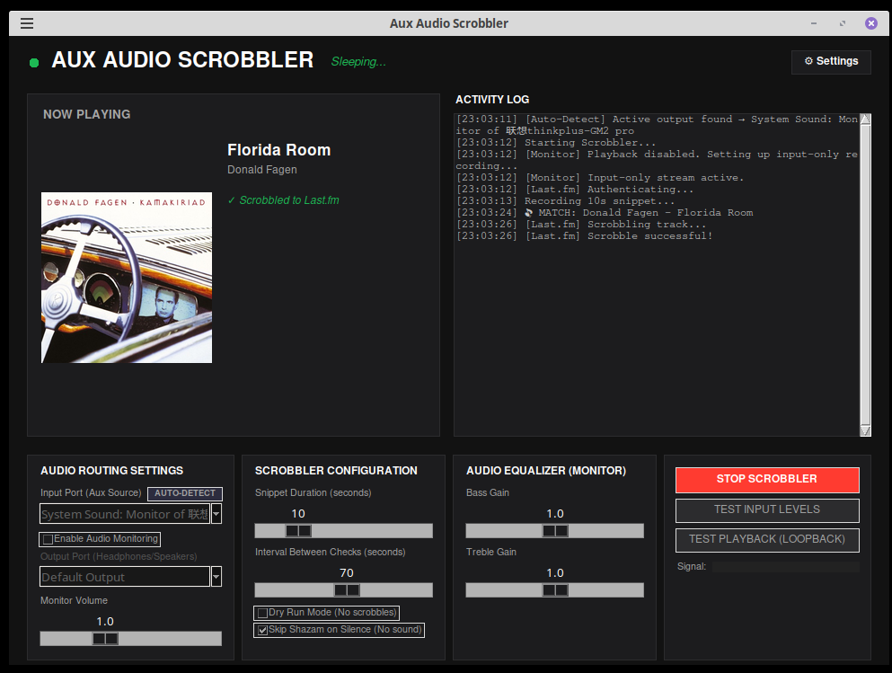

# 📻 Aux & System Audio Scrobbler

**Automatically recognize and scrobble anything playing through your computer** whether it's an external analog source via **Aux / Line-in** (radio, tape deck, vinyl, CD player) or **system-wide desktop audio** (browsers, streams, local players, games) straight to your Last.fm profile using Shazam.

Comes with standalone **Linux AppImage** build.



---

## Features

-  **System-wide audio scrobbling** — capture any PulseAudio/PipeWire monitor source directly from the GUI, **no virtual cables needed**
-  **One-click `AUTO-DETECT`** — automatically finds whichever output sink is currently playing (speakers, headphones, Bluetooth, USB DAC) and selects its monitor source
-  **Aux / Line-in capture** - plug in any external analog device and scrobble in real time
-  **Loopback monitoring** - listen to your Aux input through headphones/speakers while recording
-  **Bass / Treble EQ + Volume** - real-time tone and gain controls on the monitor output
-  **Shazam track recognition** - powered by `shazamio` (no Shazam API key required)
-  **Last.fm scrobbling** - supporting both password and session-key auth
-  **Live signal-level meter** — verify input levels visually before or during scrobbling

---

## How It Works

```
Aux / Line-in ───────┐
                     ├──► sounddevice ──► 10s snippet ──► Shazam API
System Audio (Sink) ─┘         │                               │
                           loopback                       artist + title
                          (optional)                           │
                                                        Last.fm scrobble
```

1. **Audio capture** — records short snippets (default 10 s) from any input device via `sounddevice`.
2. **Silence skip** — measures RMS/peak; if below threshold the Shazam call is skipped entirely.
3. **Recognition** — the snippet is sent to Shazam via [`shazamio`](https://github.com/dotX12/shazamio).
4. **Duplicate prevention** — tracks the last-scrobbled song + timestamp; repeats are ignored until the song's estimated duration has passed.
5. **Scrobbling** — submits the track to Last.fm using [`pylast`](https://github.com/pylast/pylast).

---

## Requirements

- Python 3.10+
- Linux with **PortAudio** (`libportaudio2`) for `sounddevice`
- PulseAudio or PipeWire (optional, enables system-audio capture in GUI)

Install system dependency:
```bash
sudo apt-get install libportaudio2
```

---

## Installation

```bash
# 1. Clone the repo
git clone https://github.com/your-username/aux-audio-scrobbler.git
cd aux-audio-scrobbler

# 2. Create and activate a virtual environment
python3 -m venv .venv
source .venv/bin/activate

# 3. Install Python dependencies
pip install -r requirements.txt
```

---

## Configuration

### Option 1: GUI Settings (recommended)
Click **⚙ Settings** in the top-right corner of the GUI (or fill out the setup dialog that opens automatically on first launch). Credentials are saved to `~/.config/aux-audio-scrobbler/credentials.env` with `600` permissions.

### Option 2: `.env` file (CLI / development)
Copy the example env file and fill in your credentials:
```bash
cp .env.example .env
```

Edit `.env`:
```env
LASTFM_API_KEY=your_api_key_here
LASTFM_API_SECRET=your_api_secret_here
LASTFM_USERNAME=your_lastfm_username

# Auth method A — plaintext password (hashed automatically)
LASTFM_PASSWORD=your_lastfm_password

# Auth method B — pre-generated session key (preferred)
# LASTFM_SESSION_KEY=your_session_key_here
```

> [!NOTE]
> Local `.env` overrides `~/.config/aux-audio-scrobbler/credentials.env` if both exist.

Get your API credentials at [last.fm/api/account/create](https://www.last.fm/api/account/create).

> [!NOTE]
> If no credentials are found, the app falls back to **dry-run mode**: tracks are identified but not scrobbled.

---

## Usage

### GUI (recommended)

```bash
./start.sh
# or:
source .venv/bin/activate && python3 gui.py
```

| Control | Description |
|---|---|
| **Input Port** | Select aux/line-in or any system monitor source |
| **AUTO-DETECT** | Finds the currently active PulseAudio/PipeWire sink automatically |
| **Enable Audio Monitoring** | Routes input to your headphones/speakers in real-time |
| **Snippet Duration** | How many seconds to record for each Shazam query (5–30 s) |
| **Interval** | Seconds to wait between recognition attempts (15–120 s) |
| **Dry Run** | Identify tracks without scrobbling |
| **Skip on Silence** | Skip Shazam API call when no audio is detected |
| **Bass / Treble / Volume** | Real-time EQ and volume on the monitor output |
| **TEST INPUT LEVELS** | Runs a 3-second level check with visual meter |
| **TEST PLAYBACK (LOOPBACK)** | Quick loopback test before starting the scrobbler |

### CLI

List audio devices:
```bash
python3 recognizer.py --list-devices
```

Start scrobbling from device index 11 with loopback monitoring:
```bash
python3 recognizer.py --device 11 --monitor
```

Dry-run (identify only, no scrobbling):
```bash
python3 recognizer.py --device 11 --dry-run
```

All options:
```
--device INT          Input device index (default: system default)
--output-device INT   Output device index for monitor (default: system default)
--duration INT        Snippet length in seconds (default: 10)
--interval INT        Sleep between checks in seconds (default: 70)
--rate INT            Sample rate in Hz (default: 44100)
--monitor             Enable real-time loopback monitoring
--dry-run             Identify tracks without scrobbling
--list-devices        Print all available audio devices and exit
```

### Check Input Levels (standalone)

```bash
python3 recognizer.py --check-levels             # uses system default input
python3 recognizer.py --check-levels --device 11 # specify device index
```

---

## Building a Standalone AppImage (Linux)

To package the GUI into a single portable executable (`dist/AuxAudioScrobbler-x86_64.AppImage`) that bundles Python, all dependencies, and `libportaudio2`:

```bash
./build_appimage.sh
```

Then run it from anywhere:
```bash
chmod +x dist/AuxAudioScrobbler-x86_64.AppImage
./dist/AuxAudioScrobbler-x86_64.AppImage
```

---

## Project Structure

```
.
├── gui.py                 # Tkinter GUI + Last.fm Settings dialog
├── recognizer.py          # CLI scrobbler + shared recognition & credential helpers
├── audio.py               # Shared AudioRecorderMonitor class (EQ, loopback, recording)
├── start.sh               # Convenience launcher for the GUI (with venv check)
├── build_appimage.sh      # Builds dist/AuxAudioScrobbler-x86_64.AppImage
├── packaging/             # Desktop entry and icon for AppImage
├── requirements.txt       # Python dependencies
├── .env.example           # Credential template
└── .gitignore
```

---

## License

MIT
